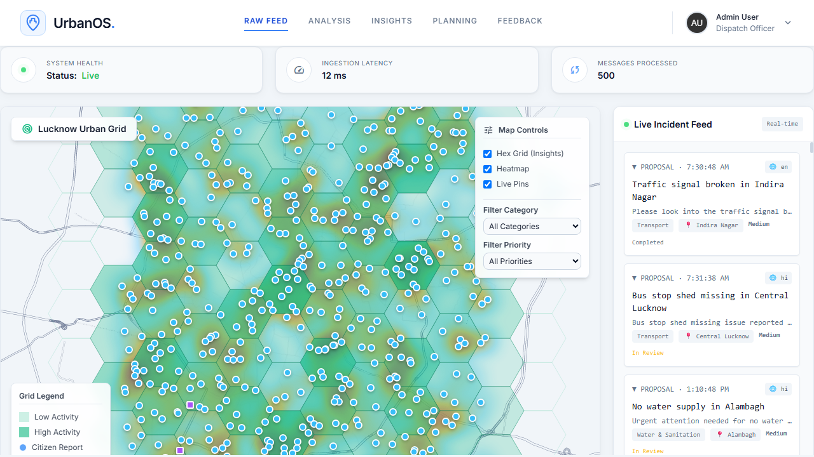
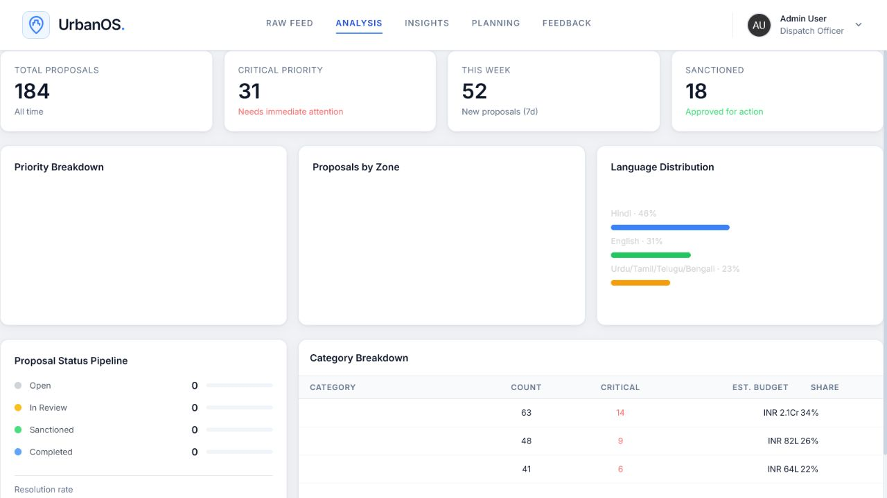
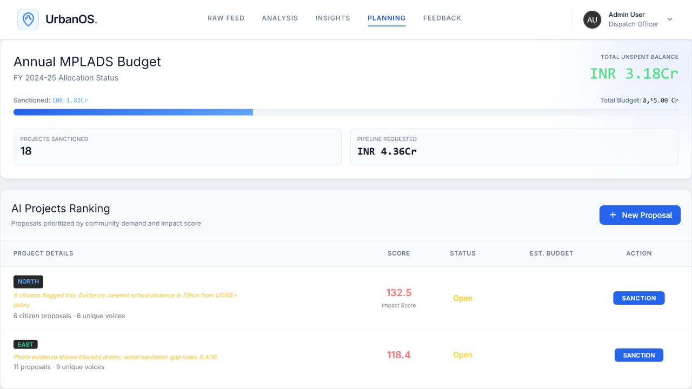
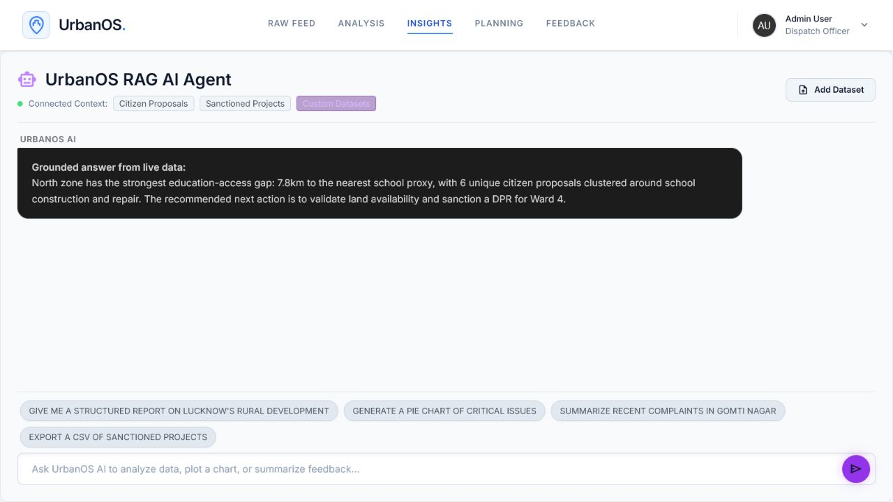
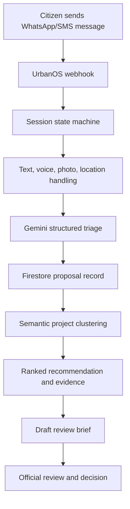

# UrbanOS

**The AI layer between a citizen's voice and an MP's development decision.**

[Live demo](https://urbanos.web.app) · Firebase + FastAPI · Gemini multimodal triage · WhatsApp/SMS intake · Firestore realtime dashboard

---

## The Monday Morning Problem

An MP's office does not receive development priorities in a clean spreadsheet.

It receives them as WhatsApp forwards from booth workers, voice notes from villages, letters from gram panchayats, public meeting notes, photos of broken drains, Facebook posts, and calls from local representatives. By the time the office has to decide what to sanction this quarter, there may be forty competing demands:

- repair a school roof,
- build a vocational training centre,
- clear a drainage line,
- install streetlights,
- upgrade a health sub-centre,
- repair a road that keeps flooding.

The problem is not that citizens do not speak. The problem is that their voices arrive in formats the office cannot compare.

UrbanOS turns that messy public input into a ranked, evidence-backed planning queue.

---

## What We Built

UrbanOS is a working civic planning prototype for constituency development.

Citizens submit proposals through WhatsApp or SMS using text, voice, photos, or location pins. Triage turns those inputs into structured reports. Planning groups related reports, explains the ranking, and lets reviewers prepare a draft brief for the official decision.

The core idea is simple:

> Do not ask citizens to learn a new government portal. Meet them where they already complain, explain, and organize.

---

## Screenshots

### Live Intake
Incoming citizen reports appear as a live webhook feed, with location and system telemetry visible to the MP office.



### Analysis
The dashboard tracks proposal volume, criticality, language distribution, and sector-level demand.



### AI Planning Queue
Projects are ranked by citizen demand, urgency, budget, and category-specific deprivation signals.



### Insights Agent
The AI assistant answers questions only from connected UrbanOS data: proposals, sanctions, surveys, and uploaded datasets.



---

## Why This Is Different

Most civic tools stop at grievance collection. UrbanOS is built around planning.

**We do not only store complaints.** We cluster them into projects an MP can act on.

**Staff can inspect the evidence.** Each recommendation shows how the submitted reports contributed to the score and identifies the coverage and age of any published evidence.

**Staff can prepare a shortlist.** Reviewers can reorder the draft and export their reasons for the official who makes the decision.

**We do not force one input format.** A citizen can type, speak, send a photo, or share a GPS pin. SMS fallback exists for low-connectivity cases.

---

## Product Flow



---

## The AI Work

UrbanOS uses Gemini for three real jobs:

1. **Structured civic triage**  
   The model returns schema-constrained JSON, not loose prose. Each proposal gets a category, priority, estimated budget, zone, short summary, language, and semantic tag.

2. **Multimodal evidence extraction**  
   If a citizen attaches a photo, the backend fetches the Twilio media securely and sends the image bytes to Gemini. The stored record includes `visual_evidence`, such as visible flooding, broken pavement, or roof damage.

3. **Grounded insights agent**  
   The dashboard chat builds its context from live Firestore proposals, sanctions, uploaded datasets, and aggregate counts. Legacy canned demo responses have been removed; if Gemini quota is exhausted, the endpoint returns a graceful data summary instead of crashing.

---

## Project Recommendations

Planning separates sourced examples, simulated reports, signature-checked intake, and history with unknown provenance. GPS reports with the same issue type can group across hex boundaries when they fall within 150 metres and 72 hours of the first report. The generator can also group reports by a known simulation site. Reports with uncertain locations stay separate. Each identified reporter contributes their highest urgency weight once. Historical public evidence is dated and shown alongside the score for the official to review.

The shortlist is a browser-local draft. Reviewers can reorder it, record reasons, and download a brief. The read-only `GET /api/planning/recommendations` and `GET /api/planning/recommendations/{project_id}` endpoints accept a `scope` and paginate recommendations and supporting references respectively. The legacy `/projects/ranked` contract continues to serve existing map markers.

---

## Things Judges Might Miss

- **Review drafts are local.** Preparing a draft leaves report status and citizen messaging untouched. The legacy sanction endpoint requires a verified Firebase account on the `ADMIN_EMAILS` allowlist.
- **The Twilio webhook validates signatures** when `TWILIO_AUTH_TOKEN` is configured.
- **Voice notes are asynchronous.** The webhook replies quickly, then the worker transcribes audio and continues the session.
- **The AI chat degrades gracefully.** Gemini quota/rate-limit errors return useful live aggregate context instead of a 500.
- **The repo is submission-clean.** Virtualenv, local DB files, Firebase cache, and generated bytecode are ignored/untracked.

---

## Tech Stack

| Layer | Choice | Why |
|---|---|---|
| Citizen intake | Twilio WhatsApp + SMS | No new app, low friction, familiar behavior |
| AI | Gemini 2.5 Flash Lite | Fast multimodal triage and structured JSON |
| Backend | FastAPI on Python 3.11 | Async-friendly API with simple deployment |
| Database | Cloud Firestore | Realtime dashboard and flexible civic records |
| Hosting | Firebase Hosting + Cloud Functions | Works for a constituency office without server ops |
| Frontend | Vanilla JS + Tailwind CDN | No build step, easy hackathon deploy |
| Maps | Leaflet + OpenStreetMap | Free map layer, no paid map API required |

---

## Run Locally

```bash
python -m venv venv
venv\Scripts\activate
pip install -r requirements.txt
cp .env.example .env
uvicorn main:app --reload
```

Then open:

```text
http://127.0.0.1:8000
```

For WhatsApp testing:

```bash
ngrok http 8000
```

Set the Twilio webhook to:

```text
https://<ngrok-url>/webhook/whatsapp
```

Optional SMS fallback:

```text
https://<ngrok-url>/webhook/sms
```

---

## Environment Variables

```env
GEMINI_API_KEY=your_gemini_api_key
TWILIO_ACCOUNT_SID=your_twilio_sid
TWILIO_AUTH_TOKEN=your_twilio_auth_token
TWILIO_WHATSAPP_NUMBER=whatsapp:+14155238886
FIREBASE_API_KEY=your_firebase_web_api_key
ADMIN_EMAILS=mp-office@example.com,aide@example.com
```

Do not commit `.env` or `firebase-key.json`.

---

## Testing

Run the Python unit, feature, and edge-case tests with `python -m pytest -q --ignore=tests/e2e`.

Install the desktop browser test dependencies and run the full suite from the repository root.

```sh
python -m pip install -r requirements-test.txt
python -m playwright install chromium
python -m pytest -q
```

The desktop tests open the real dashboard against a local FastAPI server with in-memory Firestore and a recording Twilio double. They exercise live intake, every dashboard tab, evidence links, recommendation downloads, and successful, cancelled, and failed survey sends. The browser loads the dashboard's JavaScript and CSS from its configured CDNs.

Set `URBANOS_SMOKE_URL` to a deployed dashboard URL and run `python -m pytest -q tests/e2e/test_production_smoke.py` for a read-only deployment check. The browser blocks requests other than GET and HEAD in that test.

### Prototype case operations

Open **Analysis → Case Desk** to filter cases by source, department, stage, or exact case reference. A supporting report in Planning can open its matching Case Desk row. The demo desk records acknowledgment and closure for simulated cases. Signed intake is read-only. Select **Illustrative examples** to see a resolution range even when the live source lacks closure history. Ranges use the middle half of observed closure durations from at least five cases in the same source, department, and category.

Residents can use `status <reference>` in WhatsApp or follow the tracking prompts. References accept either case and an optional `#`. The lookup only returns reports filed by that sender.

**Backlog & Seasonality** shows completed calendar months and same-month comparisons with the prior year where available. The historical backlog omits completed cases with unknown closure dates and reports how many were omitted.

In the WhatsApp sandbox, send a photo first and then send a location to file a photo-only case. It remains in review when a photo-capable triage model is unavailable. The Awadhi regression test uses a stubbed transcript and verifies that the original text is carried through intake. Measuring transcription accuracy requires recordings with reference transcripts.

## Deploy

```bash
firebase login
firebase use urbanos101
firebase deploy
```

Production dashboard:

```text
https://urbanos.web.app
```

Production WhatsApp webhook:

```text
https://api-<cloud-function-hash>-uc.a.run.app/webhook/whatsapp
```

---

## Live intake capacity

Production Firebase settings route filed reports to Cloud Tasks. Recognised text issues can complete using local civic rules. Photos and ambiguous reports still depend on model capacity. The normal queue is configured for 80 dispatches per second and the urgent queue for 20, with separate concurrency limits. Dispatch settings are ceilings. A production throughput check must also measure webhook acknowledgement latency, queue age, model quota and WhatsApp delivery.

The API is configured for 32 simultaneous requests per instance across up to 32 instances. The dashboard reads at most 150 committed report changes per response and uses a timestamp and document-ID cursor to catch up during bursts. Identical dashboard reads share a short-lived response within each API instance.

The stream console offers a Dashboard load mode with up to 10,000 synthetic events per run and a target ceiling of 4,200 events per minute. This mode exercises report storage and the dashboard using local rules. The WhatsApp pipeline mode exercises the intake conversation and has separate limits.

## Limitations

This is a hackathon prototype, so we are explicit about what is real and what still needs production hardening.

- **Twilio Sandbox:** the demo can run through Twilio Sandbox; production needs a verified WhatsApp Business number.
- **Infrastructure data:** the sourced examples use dated municipal evidence. Current site conditions and official ward assignments still need verification.
- **AI confidence:** Gemini triage should be human-reviewable before sanctions in production.
- **Privacy:** phone numbers are stored as senders today; production should hash/anonymize citizen identifiers where possible.
- **Scale:** Firestore scans are acceptable for the prototype but should move to precomputed aggregates/queues at district scale.
- **Offline inclusion:** SMS fallback exists; IVR/USSD is the next step for citizens without WhatsApp or literacy comfort.

---

## Future Roadmap

1. **Multi-constituency tenancy**  
   One deployment serving multiple MPs, each with isolated data and role-based permissions.

2. **Evidence-grade datasets**  
   Replace static proxy layers with live UDISE+, NHM, Census, ward boundary, public works, and budget datasets.

3. **Human-in-the-loop triage**  
   Let aides approve or correct AI category, budget, priority, and clustering before ranking.

4. **IVR and public-meeting import**  
   Add voice-call intake and a fast aide-entry mode for public meetings.

5. **Public transparency page**  
   Publish non-sensitive sanctioned projects, status, budget, and expected completion date.

6. **Audit and anti-gaming controls**  
   Deduplicate coordinated spam, detect repeated submissions, and log every administrative action.

---

## The Bigger Picture

India has 543 Lok Sabha constituencies. Each MP office hears from people every day, but the signal is trapped inside informal channels.

UrbanOS does not replace the MP, the aide, or the public meeting.

It gives the office a defensible listening layer: one that can say, with evidence, "this is what people are asking for, this is where the need is highest, this is what we acted on, and these are the citizens we informed when it moved."

That feedback loop is the product.
